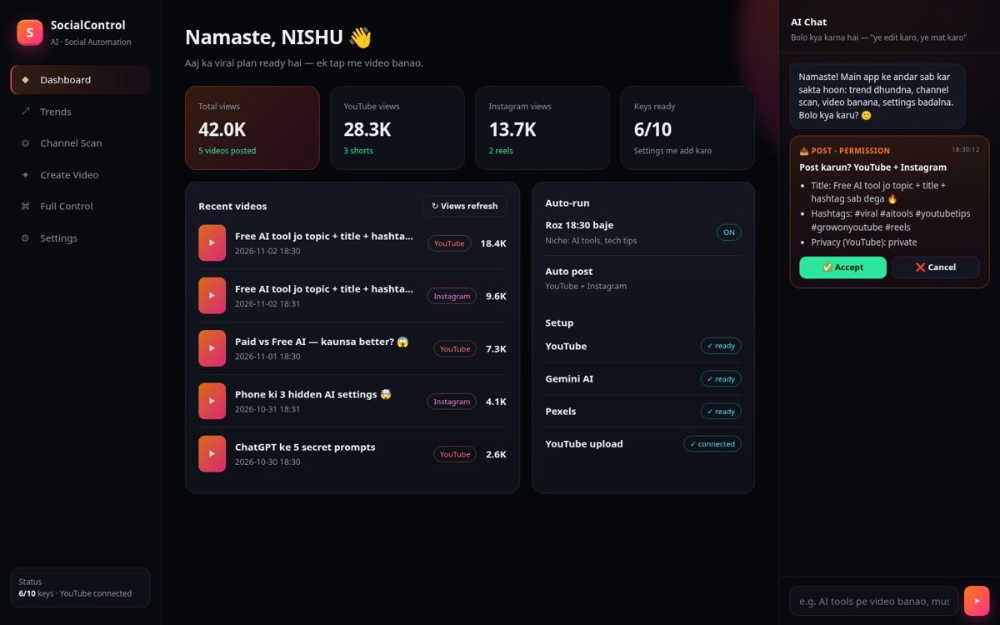

# 🤖 SocialControl AI — Social Automation

**Viral topic dhundo → channel scan karo → AI video banao (copyright-safe) → YouTube Shorts + Instagram Reels pe post → views track karo.**
PC (Windows/Mac/Linux) app + phone dashboard. Har badlaav se pehle AI chat me **✅ Accept / ❌ Cancel** poochta hai.

🌐 Live demo (sample data, koi key nahi): **https://socialcontrol.sites.tab.bot**
👤 By Nirbhay Sharma (NISHU) · YouTube [@javagoat9](https://www.youtube.com/@javagoat9) · Instagram [@shanir.ai](https://instagram.com/shanir.ai)



---

## ✨ Kya kya karta hai (sirf core features)

| Screen | Kaam |
|---|---|
| **Dashboard** | Total views (YouTube + Instagram alag), recent videos, auto-run status |
| **Trends** | YouTube trending (India) + Google Trends + Instagram hashtags → viral score ke saath topic list |
| **Channel Scan** | Kisi bhi channel ki saari videos + views → **100+, 200+, 300+, 400+, 500+, 1K+, 10K+…** buckets → sabse zyada chalne wale topics |
| **Create Video** | Topic → Gemini script/title/description/5 hashtags → stock clips / AI images / AI video → Hindi voice → 9:16 edit (Roman-Hinglish word-by-word captions, **yellow keyword highlight**, music ducking) → post |
| **Full Control** | App ke **andar** ka private browser: aap khud login karo → **Share Control** → AI YouTube Studio me channel analyse karta hai → topic list → videos banata hai. Animated cursor se sab dikhta hai |
| **Settings** | Saari API keys + saare options **sirf yahin** (har option ek hi jagah) |
| **AI Chat (side panel)** | "AI tools pe video banao", "Instagram pe post mat karo" — AI app ke features chalata hai |

### 🔐 Trust rules (code me built-in)
- **Permission card:** video banana, post karna, title/description/tags badalna, Full Control ka har change, settings change — sab se pehle chat panel me card aata hai. **Accept** = kaam shuru, **Cancel** = kuch nahi badlega.
- **App aapka PC/phone control nahi karta.** Na mouse, na keyboard, na screen. Sab kuch sirf app ki apni window me.
- **Full Control session apne aap delete:** browser ka session memory-only hota hai (disk pe save nahi), aur Stop/khatam hote hi cookies, storage, cache sab mita diya jata hai → UI me "Session deleted ✅".
- **Password kabhi app me nahi:** login aap khud Google ke apne page pe karte ho.
- **Keys sirf aapke PC pe** (`data/settings.json` ya `.env`) — dono `.gitignore` me hain, GitHub pe kabhi nahi jaate. GitHub Actions me keys **repo Secrets** me.
- **Copyright-safe:** sirf Pexels, Pixabay (free license), AI images/videos, aur aapki apni music files. Dusron ka content (Pinterest/Instagram se uthana) is app me nahi hai — edit karke bhi strike aa sakti hai. Pinterest sirf **apni** video post karne ke liye (optional).

---

## 🚀 Setup — Windows (step by step)

**Step 1 — ye 3 cheezein install karo (ek baar):**
1. **Python 3.11+** → https://www.python.org/downloads/ (install karte waqt ✅ "Add python.exe to PATH")
2. **Node.js LTS** → https://nodejs.org
3. **FFmpeg** → PowerShell me: `winget install -e --id Gyan.FFmpeg`

**Step 2 — code download + setup:**
```bat
git clone https://github.com/shanir01/SocialControl.git
cd SocialControl
scripts\setup-windows.bat
```
(Git nahi hai? GitHub pe **Code → Download ZIP**, extract karo, folder me `scripts\setup-windows.bat` double-click.)

**Step 3 — app chalao:** `scripts\start-windows.bat` (ya `npm start`)
App khulega → **Settings** me keys daalo → **Save**.

**Installer (.exe) chahiye?** `npm run dist:win` → `dist/` folder me setup.exe banega. Ya repo me tag push karo (`v1.0.0`) — GitHub Actions khud Windows/Mac/Linux installer **Releases** me daal dega.

## 📱 Phone pe kaise chalayein
1. PC pe app chalu rakho (PC aur phone **same Wi-Fi** pe).
2. App → **Settings → "Phone se kholo"** me ek address (jaise `http://192.168.1.7:8765`) aur **6-digit PIN** dikhega.
3. Phone ke Chrome me wo address kholo → PIN daalo → menu → **"Add to Home screen"** = phone app ban gaya.
4. Phone pe Full Control: AI PC pe chalta hai, phone pe **live dekh sakte ho aur Stop** daba sakte ho.

Sirf server (bina desktop app, Linux/Mac/Termux): `bash scripts/start-server-only.sh`

---

## 🔑 API keys — kaunsi, kahan se (sab free tier se shuru)

| Key | Kis kaam | Kahan se | Zaroori? |
|---|---|---|---|
| `YOUTUBE_API_KEY` | Trending + channel scan (fast) | [Google Cloud → YouTube Data API v3 → Credentials → API key](https://console.cloud.google.com/apis/library/youtube.googleapis.com) | Recommended (bina key bhi scan chalta hai, public list se) |
| `GEMINI_API_KEY` | Script, title, description, hashtags, AI images, chat, quality rating, Veo | [aistudio.google.com/app/apikey](https://aistudio.google.com/app/apikey) | **Haan** (bina iske sirf demo template) |
| `PEXELS_API_KEY` | Free stock videos/photos | [pexels.com/api](https://www.pexels.com/api/) | Haan (ya Pixabay) |
| `PIXABAY_API_KEY` | Free stock videos/photos | [pixabay.com/api/docs](https://pixabay.com/api/docs/) | Optional |
| YouTube `client_secret.json` | Auto upload + Full Control edits | [Google Cloud → Credentials → OAuth client ID → Desktop app](https://console.cloud.google.com/apis/credentials) → JSON download → repo folder me `client_secret.json` naam se rakho → Settings → **Connect YouTube** | Posting ke liye |
| `IG_ACCESS_TOKEN` + `IG_USER_ID` | Reels post + IG hashtag trends | IG ko **Professional (Creator/Business)** banao + Facebook Page se link → [developers.facebook.com](https://developers.facebook.com/tools/explorer/) (permissions: `instagram_content_publish`, `instagram_basic`, `pages_show_list`) | Instagram ke liye |
| `ELEVENLABS_API_KEY` | Premium voice | [elevenlabs.io](https://elevenlabs.io/app/settings/api-keys) | Optional — **Edge TTS free hai, Hindi voice, key nahi** |
| `FAL_KEY` / `KLING_*` / `RUNWAY_API_KEY` / `LUMA_API_KEY` | AI video (cartoon, 3D, real) | [fal.ai](https://fal.ai/dashboard/keys) · [Kling](https://app.klingai.com/global/dev/api-key) · [Runway](https://dev.runwayml.com/) · [Luma](https://lumalabs.ai/dream-machine/api/keys) | Optional (mostly paid) |
| `PINTEREST_ACCESS_TOKEN` + `PINTEREST_BOARD_ID` | Apni video Pinterest pe post | [developers.pinterest.com](https://developers.pinterest.com/apps/) | Optional |

Saari list `.env.example` me bhi hai (har key ke saath link).

### 🎬 AI video — "jiska result best, wahi upload"
Jitni AI video keys daaloge, app **sab se ek saath** video banwata hai, har result ko score karta hai (duration, resolution, 9:16, black frames, + Gemini vision rating 0-10), aur **best wala** use karta hai. Koi provider fail ho ya limit khatam (429/402/quota) → apne aap agla, aur us provider ko 12 ghante ke liye skip. Koi AI video key nahi → Pexels/Pixabay clips + AI images (Ken Burns motion) se video banti hai.
Style (Photo / Cartoon / 3D / Stock) → Settings me.

---

## ⏰ Roz auto video
- **App me:** Settings → "Roz auto-run" ON + time. (App/PC chalu hona chahiye.) Har video/post se pehle permission card aayega.
- **24x7 (PC band ho tab bhi):** GitHub Actions — repo → **Settings → Secrets and variables → Actions** me keys daalo (same naam). `YT_TOKEN_JSON` = PC pe Connect YouTube ke baad bani `data/yt_token.json` ka content. Phir **Actions → Daily video → Run workflow**. ⚠️ Actions me Accept dabane wala koi nahi hota, isliye wahan `SC_AUTO_APPROVE=1` hai — tabhi use karo jab aap bharosa karo; video pehle **private** upload hoti hai.

---

## 🧪 Bina key ke test karo
```bash
pip install -r requirements.txt
cd backend
python -m socialcontrol demo        # local test visuals + free Hindi voice -> 9:16 captioned mp4 (data/runs/...)
python -m socialcontrol trends      # Google Trends (no key)
python -m socialcontrol scan @javagoat9   # public channel list (no key) -> buckets + top topics
python -m pytest -q                 # 19 tests: buckets, scoring, fallback, captions, editor, permission gate
```

## ⚠️ Full Control — zaroori baat
- Recommended tarika: **Settings → Connect YouTube** (official OAuth/API). Isse title/description/tags/comments ka kaam official API se hota hai — safe.
- Full Control ka browser part YouTube Studio ko automation se chalata hai. **Google ise security check / "unusual activity" maan sakta hai, aur YouTube ki Terms of Service automated access allow nahi karti.** Iska use **apne risk pe** karo. Isliye: har change se pehle permission, Stop button hamesha, aur session khatam hote hi delete.
- Google kabhi-kabhi embedded browser me login block karta hai ("This browser may not be secure"). Aisa ho to Settings → Connect YouTube (API mode) use karo — wo Google ka apna page aapke normal browser me kholta hai.

## 🗂️ Code ka naksha
```
backend/socialcontrol/   Python: trends, channel_scan, ai (Gemini), media (Pexels/Pixabay/AI), voice (Edge TTS/ElevenLabs),
                         editor (FFmpeg 9:16 + captions + ducking), videogen/ (providers + scoring + fallback),
                         poster (YouTube/Instagram/Pinterest), tracker, approvals (permission gate), chat, scheduler, server
desktop/                 Electron app: main.js (window + server), agent.js (Full Control in-app browser), preload.js
web/                     Dashboard UI (PWA, phone + desktop) — demo mode: add ?demo=1
.github/workflows/       daily video, desktop installers, tests
```

## ✅ Kya test hua / kya aapki keys se test hoga
**Test ho chuka (bina key):** Google Trends topics, channel scan (@javagoat9: 24 videos, 53K views — buckets + top topics), Edge TTS Hindi voice, 9:16 editor (captions, yellow highlight, end card, ducking), AI-video scoring + auto-fallback + quota cooldown, permission gate, scheduler, chat rules — 19 tests pass.
**Aapki keys se pehli baar chalega (code ready, live test baaki):** Gemini script/images/chat, Pexels/Pixabay download, Veo/Kling/Runway/Luma/fal video, YouTube upload + edits (OAuth), Instagram Reels publish, Pinterest pin, views refresh, desktop app ka Full Control (Windows pe `npm start`).

MIT License · Made with ❤️ for NISHU
